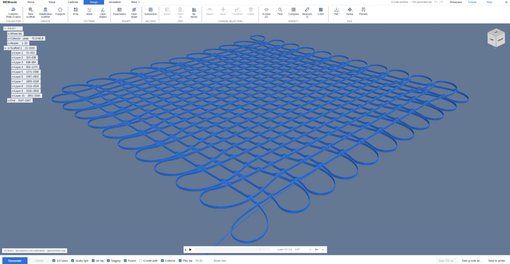
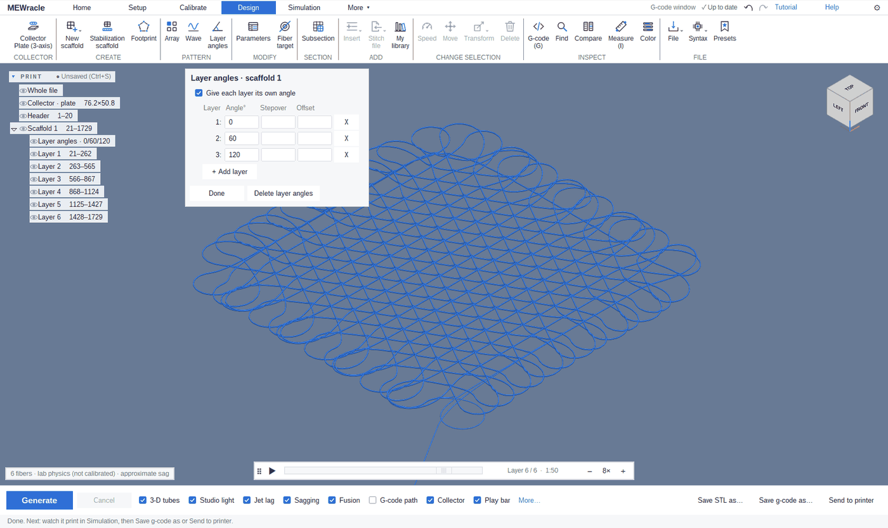
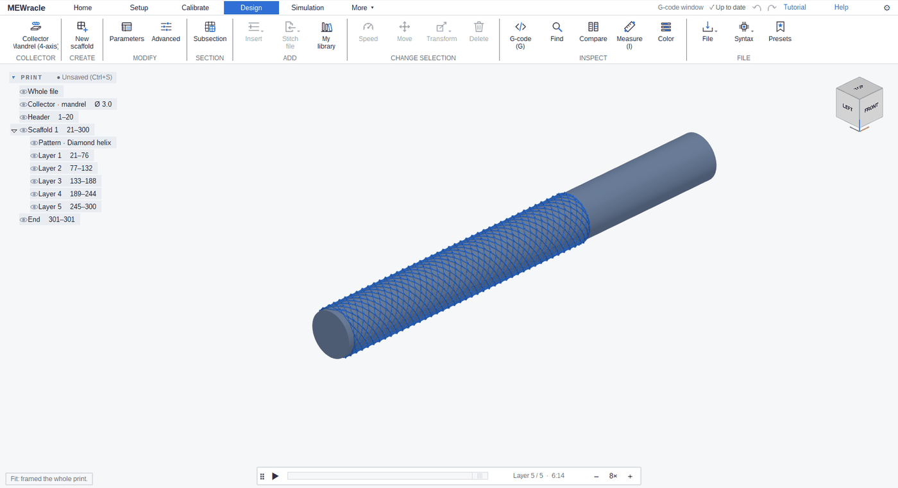
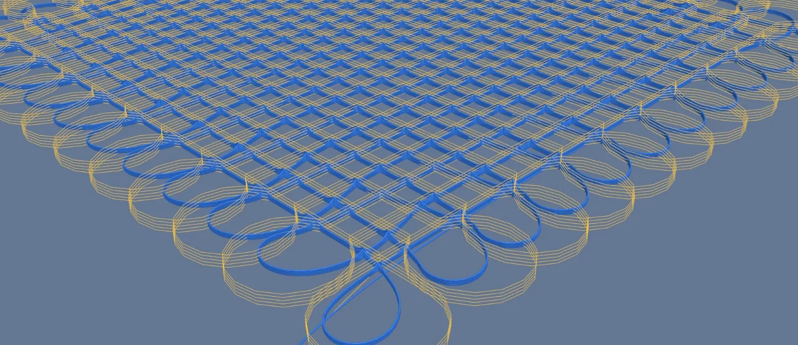
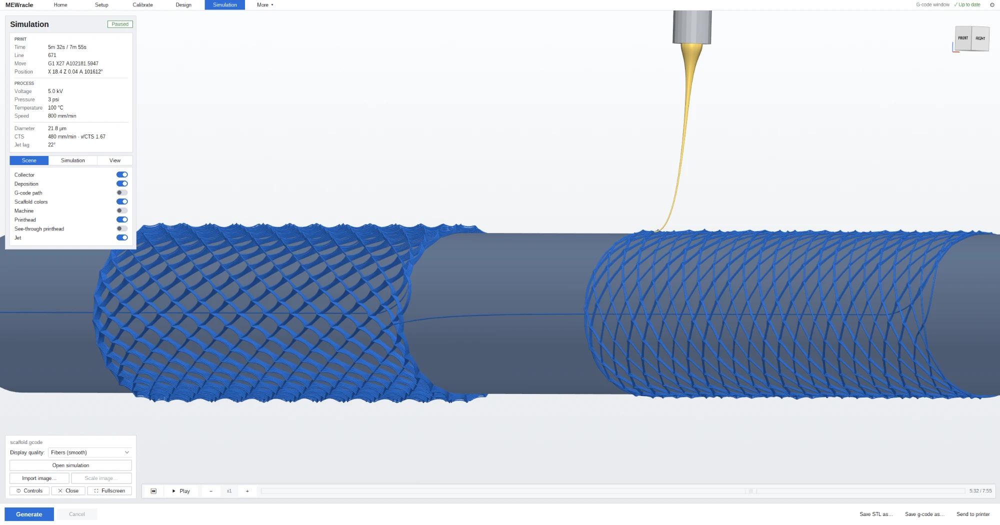
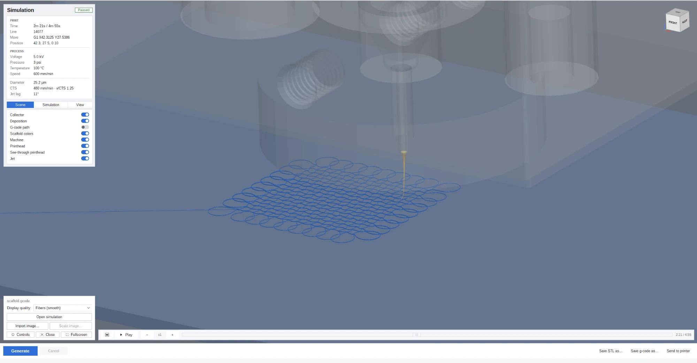
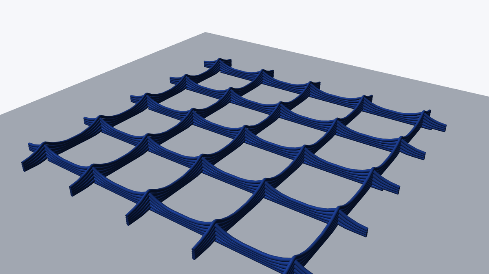

# MEWracle

**Open-source software for designing melt electrowriting (MEW) scaffolds and modelling how they print, on any MEW printer. It is built to be where the field's next advances in scaffold design and physical modelling happen.**

Design a scaffold, and MEWracle writes the G-code and shows you where every fiber will land: how far the jet trails the nozzle, how much each fiber sags between crossings, and how far it fuses into the layer below. Calibrate it on your printer, and those predictions are for your machine.

## From design to print

The app's top row is the workflow, left to right.

1. **Setup.** Describe your printer once: the collector, where G-code zero is, your firmware, and your process settings. Save it as a preset.
2. **Calibrate.** Print a short test, measure it, and fit the model to your printer and polymer. Optional at first.
3. **Design.** Build the scaffold and press Generate.
4. **Simulation.** Watch the printhead lay every fiber in 3-D.
5. **Save or send.** Save the G-code, or send it to the printer over the network. Print History keeps a record of every run.

The Home page walks you through these steps, and a guided tour takes two minutes.

## What people use it for

- **Trying a new architecture before spending polymer on it.** Graded pores, wavy fibers, square pores below triangles above, or tubes on a mandrel.
- **Choosing process settings.** Type the fiber diameter you want, and MEWracle gives the pressure, speed or temperature that makes it.
- **Working with G-code you already have.** Open it, see how it prints, edit it by hand, or print a new design beside a control you trust.
- **Meshing a scaffold for simulation.** Export the modelled fibers, or a few pores of them, as an STL.
- **Keeping a lab record.** Every run's settings are saved, and two runs can be compared side by side.

Eight demo designs in the presets list show these at work.

## Design

The Design page holds everything. The ribbon holds the tools, the tree on the left lists the print scaffold by scaffold and layer by layer, and the 3-D preview redraws as you change a setting. Set the footprint, fiber spacing, layer count and layer angles.

Grade the pore size across a layer, make the fibers wave, or put several scaffolds in one print, side by side or stacked. The footprint can be a rectangle, circle, ellipse, polygon or an outline you draw. Tile a scaffold into an array, or add a small stabilization scaffold beside it so the jet is steady before the scaffold starts.

Switch the collector to a rotating mandrel, and the same page designs tubes. Set the winding angle, pore size, length and layers, and MEWracle writes the 4-axis G-code.

The G-code itself is open to you on the same page. Edit any line, insert a dwell, a temperature or a pressure change, stitch in another file, or keep commands you reuse in My library. Compare shows every difference from the plain design and what made it.

## See how it prints

Every design is modelled before you print it. Each fiber sags between the fibers that hold it up and settles onto the layer below.

Turn on the G-code path to compare where the nozzle goes with where the fiber lands. Show deviation colours each fiber by how far it lands from its path.

Then play the print back and scrub to any moment. The jet lays every fiber in order, trailing the nozzle as it does on the machine, on a flat collector or a turning mandrel, with your printer drawn around it. After printing, lay a micrograph of the real scaffold over the model to see how they match.

## The physics you can tune

Each of these effects is modelled, and each can be calibrated to your printer and polymer.

| Effect | What it depends on |
|---|---|
| Fiber diameter | Pressure, needle, melt viscosity and print speed |
| Melt viscosity | Temperature |
| Critical speed | Your printer and polymer. Below it the fiber coils, and MEWracle draws the coils |
| Jet lag | Print speed and the nozzle's height. The faster you go above the critical speed, the further the fiber lands behind the nozzle |
| Sagging | The gap between the fibers that hold a fiber up |
| Fusion | How far a fiber sinks into the still-soft fiber beneath it |

Fiber target works backwards. Type the fiber diameter you want, and it tells you the pressure, speed or temperature that will make it, and marks what your printer cannot reach.

## Calibrate to your printer

The Calibrate page has a procedure for every effect above: critical speed and jet lag, each on a plate or a mandrel, viscosity and how it changes with temperature, sagging and fusion. Each one walks you through a test print, tells you what to measure, and fits the model to your measurements. Apply the result, and from then on every prediction is for your printer and your polymer.

## What you can export

| Export | For |
|---|---|
| G-code | Your printer, in Klipper, RepRapFirmware (Duet), Marlin, GRBL or Aerotech syntax, or a flavor you define |
| STL of the modelled fibers | Meshing and simulation |
| STL of a subsection | A box, circle, sphere or outline cut from the print, a few pores say |
| Print History CSV and PDF | Your lab notebook: every setting of a run, with your notes and a picture of the fibers |
| Presets | Sharing a design, a printer setup or your physics values with a colleague |

## Records and printers

- **Print History** records every Generate. Reproduce an old run, compare two, add notes, or graph one setting across runs.
- **Printer link** talks to a Klipper printer running Moonraker over the network. Send a job, watch it move, set temperatures and jog.
- Any other printer runs the saved G-code file as usual.
- Dark mode is one key away (Ctrl+D).

## Get started

**Download the app (Windows)**

1. Download the newest zip from [Releases](https://github.com/umpquajoseph/MEWracle/releases).
2. Unzip it.
3. Double-click `MEWracle.exe` in the unzipped folder.
4. Optional: to see the MEWron 0.2 printer in 3-D, copy this repository's `machine_models` folder next to `MEWracle.exe`.

**Or get the source (Windows)**

1. `git clone https://github.com/umpquajoseph/MEWracle`
2. Double-click `Setup.bat` and press Install.
3. Open MEWracle from the new desktop shortcut.

## Before you rely on a number

MEWracle starts with values measured on the developers' printer. Until you calibrate it on yours, treat every diameter, lag and sag it shows as an example, not a prediction for your machine.

## Build on it

MEWracle is open source under the AGPL. Every model above is in the code, to read, question and replace. A new scaffold pattern, a better physical model or support for another printer can go in for everyone who uses it.

## Cite, licence, contact

- **Cite:** if MEWracle helps your research, please cite it using [CITATION.cff](CITATION.cff). A paper describing it is in preparation.
- **Licence:** GNU AGPL-3.0, see [LICENSE](LICENSE). Copyright and third-party notices are in [NOTICE](NOTICE).
- **Bugs and questions:** open an issue on [GitHub Issues](https://github.com/umpquajoseph/MEWracle/issues).
